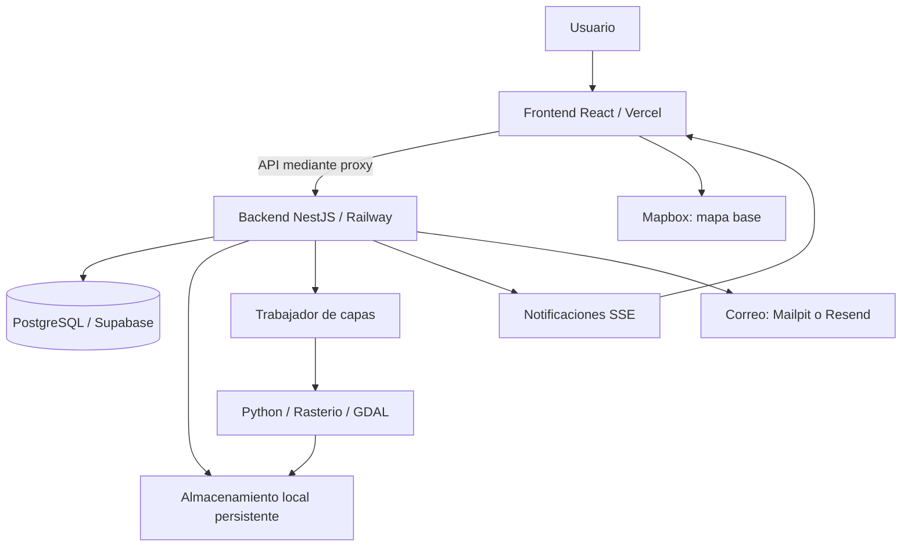

<div align="center">

# INGEVIT 360

### Gestión visual y geográfica de proyectos de obra

Fotografías, panorámicas 360°, planos e incidencias conectados con el contexto de cada proyecto.

**[Explorar la aplicación](https://ingevit.vercel.app/)**

React · TypeScript · NestJS · PostgreSQL · Mapbox GL JS · Python / Rasterio / GDAL

</div>

---

## Sobre el proyecto

**INGEVIT 360** es una aplicación web para centralizar la documentación visual y el seguimiento de proyectos de obra. Reúne información que suele quedar distribuida entre carpetas, fotografías, planos y mapas, y permite consultarla dentro del mismo espacio de trabajo.

El sistema relaciona los recursos de un proyecto con su ubicación geográfica y sus incidencias. Un equipo puede revisar una fotografía, explorar una panorámica, consultar un plano PDF o visualizar una ortofoto, conservando el contexto del proyecto y el acceso de sus participantes.

El desarrollo combina una interfaz en React, una API modular en NestJS, persistencia relacional en PostgreSQL y procesamiento geoespacial para convertir ortofotos en capas navegables.

## Contenido

- [Funcionalidades](#funcionalidades)
- [Recorrido de uso](#recorrido-de-uso)
- [Tecnologías](#tecnologías)
- [Arquitectura](#arquitectura)
- [Estructura del repositorio](#estructura-del-repositorio)
- [Ejecución local](#ejecución-local)
- [Procesamiento de ortofotos](#procesamiento-de-ortofotos)
- [Despliegue](#despliegue)
- [API](#api)
- [Pruebas y verificación](#pruebas-y-verificación)
- [Alcance actual](#alcance-actual)
- [Documentación adicional](#documentación-adicional)
- [Licencia](#licencia)

## Funcionalidades

### Proyectos y colaboración

- Creación, consulta y actualización de proyectos.
- Ubicación geográfica de los proyectos y visualización en mapa.
- Incorporación y retiro de colaboradores.
- Consulta de participantes e historial de actividades.
- Organización de fotografías, panorámicas y planos en carpetas.
- Selección de fotografías como portada del proyecto.

### Fotografías

- Carga de imágenes JPG, PNG y WebP.
- Conservación del original y generación de una versión optimizada para la web.
- Visualización, descarga, edición del título y eliminación según permisos.
- Vinculación de fotografías a incidencias geográficas.

La optimización utiliza Sharp y genera imágenes WebP con un lado máximo inicial de 2.560 píxeles y un objetivo de hasta 3 MiB, aplicando ajustes de calidad y resolución cuando corresponde.

### Panorámicas 360°

- Carga de imágenes equirectangulares ya ensambladas.
- Exploración interactiva mediante Pannellum.
- Validación de formato, dimensiones y proporción aproximada 2:1.
- Gestión del título, descarga y eliminación.
- Vinculación con incidencias ubicadas en el mapa.

### Planos PDF

- Carga y visualización de documentos PDF.
- Navegación entre páginas.
- Registro de incidencias sobre una página y una posición del plano.
- Edición de información, descarga y eliminación según permisos.

### Mapas y ortofotos

- Visualización cartográfica con Mapbox GL JS.
- Carga de ortofotos GeoTIFF georreferenciadas.
- Procesamiento en segundo plano para generar teselas PNG XYZ.
- Seguimiento de estados: `PENDIENTE`, `PROCESANDO`, `LISTA` y `ERROR`.
- Reintento del procesamiento sin volver a cargar el original.
- Configuración de visibilidad, opacidad y orden de las capas.
- Acceso autenticado a las teselas y sus descriptores TileJSON.

### Incidencias y seguimiento

- Incidencias sobre planos o ubicaciones geográficas.
- Incidencias de mapa con texto, fotografía o panorámica vinculada.
- Asociación opcional de incidencias geográficas a una capa del proyecto.
- Estados `PENDIENTE`, `EN_PROCESO` y `SOLUCIONADA`.
- Prioridades `BAJA`, `MEDIA` y `ALTA`.
- Notificaciones, conteo de no leídas y actualización mediante Server-Sent Events (SSE).
- Procesamiento de correos de notificación mediante un trabajador configurable.

### Cuentas y acceso

- Registro e inicio de sesión con correo y contraseña.
- Inicio de sesión con Google.
- Recuperación y cambio de contraseña.
- Edición del perfil y del avatar.
- Roles globales `USUARIO` y `ADMINISTRADOR`.
- Control de acceso por propietario y colaboradores del proyecto.
- Endpoint administrativo para activar o desactivar usuarios.

Los roles globales y la participación en un proyecto son conceptos distintos: una sesión válida no concede acceso automático a todos los proyectos.

## Recorrido de uso

1. Iniciar sesión o registrar una cuenta.
2. Crear un proyecto y definir su ubicación.
3. Agregar colaboradores al espacio de trabajo.
4. Incorporar fotografías, panorámicas, planos y ortofotos.
5. Organizar los recursos y explorarlos desde sus visores.
6. Registrar incidencias sobre el plano o el mapa y actualizar su estado.
7. Consultar actividades y notificaciones para seguir los cambios del proyecto.

La [aplicación publicada](https://ingevit.vercel.app/) requiere autenticación para acceder al espacio de trabajo. El contenido visible depende de los permisos de cada cuenta.

## Tecnologías

| Área | Tecnologías | Uso |
|---|---|---|
| Interfaz | React 19, TypeScript, Vite 8 | Componentes, estado de la interfaz y compilación |
| Estilos | CSS y CSS Modules | Diseño y estilos por componente |
| Cartografía | Mapbox GL JS | Mapas, ubicaciones y capas raster |
| Visor 360° | Pannellum | Exploración de imágenes equirectangulares |
| Documentos | React PDF, PDF.js y pdf-lib | Visualización e inspección de PDF |
| API | NestJS 11 sobre Express | Módulos, controladores, servicios y validación |
| Persistencia | PostgreSQL y `pg` | Consultas SQL y transacciones |
| Autenticación | JWT, cookies HttpOnly, Argon2id, Google Auth Library | Sesiones, contraseñas e identidad |
| Imágenes | Sharp | Inspección y optimización |
| Procesamiento GIS | Python, Rasterio, GDAL, PROJ, NumPy y Pillow | Inspección de GeoTIFF y generación de teselas |
| Correo | Nodemailer; Mailpit en local y Resend en producción | Recuperación y notificaciones |
| Pruebas | Node.js Test Runner, NestJS Testing | Pruebas de servicios, HTTP e integración |
| Infraestructura | Vercel, Railway, Supabase y Docker | Publicación del frontend, backend y base de datos |

Las versiones exactas de dependencias se encuentran en los archivos `package-lock.json` y `backend/requirements-gis.lock.txt`.

## Arquitectura



El frontend organiza la interfaz por funcionalidades. El backend separa controladores HTTP, servicios de negocio, repositorios SQL, DTO y utilidades de procesamiento.

PostgreSQL conserva los datos y referencias de los recursos. Los archivos se gestionan con el almacenamiento local del backend; el uso de Supabase en este despliegue corresponde a PostgreSQL. Supabase Storage no es el proveedor de archivos implementado en esta versión.

Las ortofotos se sirven como teselas desde la API. No se publican como Mapbox Tilesets. El trabajador de capas ejecuta un procesamiento por ciclo en cada instancia y mantiene estados de trabajo en la base de datos.

### Controles implementados

- Hash de contraseñas con Argon2id.
- JWT con vencimiento, emisor y audiencia definidos.
- Cookie de sesión HttpOnly, `SameSite=Strict` y `Secure` en producción.
- Comprobación de origen para operaciones de escritura.
- Validación de entradas mediante DTO y pipes.
- Validación del contenido de los archivos, además de sus nombres o extensiones.
- Comprobaciones de acceso a proyectos y recursos desde el backend.
- Versionado de sesión para invalidación y controles de recuperación de contraseña.
- Transacciones y tareas de limpieza para coordinar persistencia y archivos.

Estos mecanismos describen la implementación; no constituyen una certificación de seguridad.

## Estructura del repositorio

```text
frontend/
├── src/
│   ├── assets/                 # Recursos visuales e identidad
│   ├── features/
│   │   ├── auth/               # Acceso, registro y recuperación
│   │   ├── profile/            # Perfil y avatar
│   │   ├── proyectos/          # Proyectos, recursos, mapas e incidencias
│   │   └── workspace/          # Navegación y notificaciones
│   └── shared/api/             # Cliente HTTP
├── vite.config.ts             # Servidor local y proxy /api
└── vercel.json                # Reescrituras de producción

backend/
├── src/
│   ├── common/                # Validación, acceso y utilidades compartidas
│   ├── database/              # Conexión y transacciones PostgreSQL
│   ├── modules/               # Módulos de negocio
│   └── scripts/               # Comprobaciones de base de datos
├── scripts/gis/               # Procesador GeoTIFF y pruebas Python
├── sql/                       # Cambios incrementales de base de datos
├── test/                      # Pruebas Node.js
│   └── integration/           # Pruebas con PostgreSQL
├── docs/                      # Contratos y documentación técnica
├── Dockerfile
└── requirements-gis.lock.txt
```

## Ejecución local

### 1. Requisitos

- Node.js **22.12 o posterior dentro de la rama 22**, y npm. El Dockerfile del backend utiliza Node 22; el frontend instalado exige al menos 22.12 en esa rama.
- Una instancia PostgreSQL con el esquema de INGEVIT y los permisos necesarios.
- Un identificador de cliente web de Google para la autenticación.
- Un token público de Mapbox para los mapas.
- Una carpeta local con permisos de escritura para archivos.
- Mailpit escuchando en `127.0.0.1:1025` para probar los correos en desarrollo.
- Para ortofotos: GDAL/PROJ y Python con las dependencias GIS, o el entorno Docker incluido.

### 2. Preparar la base de datos

**El directorio `backend/sql` contiene cambios incrementales sobre un esquema existente. No incluye un script completo para crear desde cero todas las tablas base del esquema `obra`.**

Antes de iniciar una instalación nueva, se necesita el esquema inicial compatible, proporcionado por el responsable del proyecto. Después deben revisarse y aplicarse los cambios SQL correspondientes al estado de esa base. No ejecutar indiscriminadamente todos los scripts sobre una base ya actualizada.

Esta preparación es un requisito previo; instalar las dependencias npm no crea las tablas.

### 3. Instalar dependencias

Desde la carpeta raíz de la copia del repositorio:

```bash
cd backend
npm ci
cd ../frontend
npm ci
```

Cada aplicación tiene su propio `package.json` y archivo de bloqueo.

### 4. Configurar el backend

Crear `backend/.env` con valores propios. Este ejemplo es para desarrollo local; sustituir todos los valores entre `<...>`:

```dotenv
NODE_ENV=development
HOST=127.0.0.1
PORT=3000

DB_HOST=127.0.0.1
DB_PORT=5432
DB_NAME=<nombre_base>
DB_USER=<usuario_base>
DB_PASSWORD=<password_base>

AUTH_JWT_SECRET=<secreto_hexadecimal_de_64_caracteres>
AUTH_RECUPERACION_SECRET=<otro_secreto_hexadecimal_de_64_caracteres>
AUTH_ALLOWED_ORIGINS=http://localhost:4300
AUTH_GOOGLE_CLIENT_ID=<cliente_web>.apps.googleusercontent.com

STORAGE_LOCAL_ROOT=C:/ingevit-data/storage

CORREO_PROVEEDOR=mailpit
CORREO_SMTP_HOST=127.0.0.1
CORREO_SMTP_PORT=1025
CORREO_REMITENTE_NOMBRE=INGEVIT 360
CORREO_REMITENTE_DIRECCION=no-reply@example.com

RECUPERACION_TRABAJADOR_HABILITADO=true
CORREO_TRABAJADOR_HABILITADO=true
ARCHIVOS_PENDIENTES_HABILITADO=true
CAPAS_TRABAJADOR_HABILITADO=false
```

Generar **dos secretos independientes**, ejecutando este comando una vez para cada variable:

```bash
node -e "console.log(require('node:crypto').randomBytes(32).toString('hex'))"
```

`STORAGE_LOCAL_ROOT` debe ser una ruta absoluta a una carpeta. En Linux, utilizar una ruta como `/var/lib/ingevit/storage` y preparar los permisos correspondientes.

El identificador Google debe ser real y tener autorizado el origen local. Su configuración se valida al construir los servicios del backend.

Los trabajadores de correo necesitan Mailpit disponible para entregar los mensajes. El trabajador de capas queda desactivado en este ejemplo hasta configurar el entorno GIS.

### 5. Configurar el frontend

Crear `frontend/.env`:

```dotenv
VITE_MAPBOX_ACCESS_TOKEN=<token_publico_mapbox>
VITE_GOOGLE_CLIENT_ID=<mismo_cliente_web_del_backend>.apps.googleusercontent.com
```

Las variables `VITE_*` se incluyen en el código del navegador: no colocar contraseñas de base de datos, secretos JWT ni claves privadas en ellas.

El cliente HTTP utiliza rutas `/api/`. En desarrollo, Vite las reenvía a `http://127.0.0.1:3000`. Existe además `VITE_API_URL` en el flujo de subida de capas; dejarla sin definir conserva el uso del origen local y su proxy.

### 6. Iniciar las aplicaciones

En una terminal, desde `backend`:

```bash
npm run dev
```

En otra terminal, desde `frontend`:

```bash
npm run dev
```

Abrir [http://localhost:4300](http://localhost:4300).

El script `dev` del backend compila y ejecuta Node con `.env`; **no activa un observador de cambios**. Después de modificar su código, es necesario reiniciarlo.

La ruta [http://127.0.0.1:3000/api/health](http://127.0.0.1:3000/api/health) devuelve el estado básico del proceso. Esta respuesta no comprueba por sí sola la disponibilidad de PostgreSQL, el correo o el procesamiento GIS.

## Procesamiento de ortofotos

El pipeline conserva el GeoTIFF original, inspecciona su georreferenciación y genera teselas para su visualización en el mapa. Los archivos temporales deben quedar separados del almacenamiento persistente.

| Configuración | Propósito |
|---|---|
| `CAPAS_MAX_ARCHIVO_BYTES` | Límite de carga; si no se define, la subida queda deshabilitada |
| `CAPAS_TEMP_ROOT` | Carpeta temporal de procesamiento |
| `CAPAS_GDALINFO_PATH` | Ruta absoluta al ejecutable `gdalinfo` |
| `CAPAS_GDAL_DATA`, `CAPAS_PROJ_DATA` | Directorios de datos de GDAL y PROJ |
| `CAPAS_GDAL_PATH` | Ruta absoluta al generador GDAL; la configuración compartida también la valida con el motor Python |
| `CAPAS_TESELAS_MOTOR` | `python` para el procesador Rasterio, o `gdal` |
| `CAPAS_PYTHON_PATH` | Ejecutable Python del entorno GIS |
| `CAPAS_RASTERIO_SCRIPT` | Ruta absoluta a `scripts/gis/procesar_geotiff.py` |
| `CAPAS_TESELAS_ZOOM_MIN`, `CAPAS_TESELAS_ZOOM_MAX` | Niveles de zoom de procesamiento |
| `CAPAS_TESELAS_HILOS` | Paralelismo configurado para GDAL |
| `CAPAS_TESELAS_TIMEOUT_MS` | Tiempo máximo del procesamiento |
| `CAPAS_TESELAS_MAX_ARCHIVOS` | Presupuesto de cantidad de teselas |
| `CAPAS_TESELAS_MAX_BYTES` | Presupuesto de bytes de teselas para Python |
| `CAPAS_RASTERIO_CACHE_MB`, `CAPAS_RASTERIO_WARP_MB` | Presupuestos de caché y reproyección |
| `CAPAS_TRABAJADOR_HABILITADO` | Activa el procesamiento en segundo plano |
| `CAPAS_TRABAJADOR_INTERVALO_MS` | Intervalo entre ciclos |
| `CAPAS_API_PUBLICA_URL` | Base accesible desde el navegador, incluyendo `/api` |

Para el proxy local, `CAPAS_API_PUBLICA_URL` puede apuntar a `http://localhost:4300/api`. En el despliegue con proxy Vercel, debe corresponder al origen público configurado para mantener el acceso autenticado a las teselas.

El Dockerfile incluye GDAL y crea un entorno Python en `/opt/ingevit-gis`; copia el procesador a `/app/scripts/gis/procesar_geotiff.py`. Las variables de entorno y los directorios de datos deben configurarse explícitamente.

Consultar [el contrato de ortofotos](backend/docs/capas-ortofotos.md) para permisos, estados, parámetros y operación. El tamaño máximo de una subida no equivale al espacio total requerido: deben caber originales, temporales y teselas generadas.

## Despliegue

La distribución utilizada por el proyecto es:

| Componente | Destino |
|---|---|
| Frontend | Vercel |
| Backend y procesamiento GIS | Railway |
| PostgreSQL | Supabase |
| Archivos y teselas | Almacenamiento persistente asociado al backend |

### Frontend en Vercel

- Directorio raíz de la aplicación: `frontend`.
- Comando de compilación: `npm run build`.
- Directorio de salida: `dist`.
- Configurar las variables públicas de Mapbox y Google antes de compilar.
- `vercel.json` reenvía `/api/:path*` al backend y resuelve las demás rutas hacia `index.html`.
- Para un despliegue propio, actualizar el destino del proxy al backend correspondiente.

### Backend en Railway

- Construir con `backend` como contexto y su `Dockerfile`.
- Definir `NODE_ENV=production`, `HOST=0.0.0.0` y el puerto asignado al servicio.
- Configurar PostgreSQL, secretos, Google y el origen HTTPS permitido.
- Montar almacenamiento persistente y apuntar `STORAGE_LOCAL_ROOT` a ese directorio.
- Configurar rutas GIS, presupuestos y trabajadores que se utilizarán.
- Para correo de producción, definir `CORREO_PROVEEDOR=resend`, `CORREO_SMTP_PASSWORD` y un remitente válido para el proveedor.

Las cookies actuales usan `SameSite=Strict`: conservar la estrategia de proxy de la aplicación y comprobar cualquier cambio a llamadas directas entre dominios. La lista CORS de `backend/src/main.ts` y `AUTH_ALLOWED_ORIGINS` son configuraciones distintas y deben ser coherentes con los dominios utilizados.

Los límites efectivos de carga también dependen del proxy y del alojamiento. Aumentar un límite en NestJS no modifica los límites de Vercel o Railway.

### PostgreSQL en Supabase

El backend utiliza `pg` y variables `DB_*` para conectarse a PostgreSQL. No usa Supabase Auth como mecanismo de sesión. Seleccionar una modalidad de conexión compatible con las funciones utilizadas, incluido el listener de notificaciones PostgreSQL.

## API

Prefijo común: `/api`.

| Método | Ruta representativa | Uso |
|---|---|---|
| GET | `/api/health` | Estado básico del proceso |
| POST | `/api/auth/register` | Registro |
| POST | `/api/auth/login` | Inicio de sesión |
| POST | `/api/auth/google` | Acceso con Google |
| GET | `/api/auth/me` | Usuario de la sesión |
| POST | `/api/auth/logout` | Cierre de sesión |
| POST | `/api/auth/recuperar-password` | Solicitud de recuperación |
| POST | `/api/auth/restablecer-password` | Restablecimiento |
| GET / POST | `/api/proyectos` | Consulta y creación de proyectos |
| GET / POST | `/api/proyectos/:idProyecto/fotografias` | Fotografías |
| GET / POST | `/api/proyectos/:idProyecto/panoramicas` | Panorámicas |
| GET / POST | `/api/proyectos/:idProyecto/planos` | Planos |
| GET / POST | `/api/proyectos/:idProyecto/capas` | Ortofotos |
| GET / POST | `/api/proyectos/:idProyecto/incidencias/mapa` | Incidencias geográficas |
| GET / POST | `/api/proyectos/:idProyecto/planos/:idPlano/incidencias` | Incidencias sobre planos |
| GET | `/api/proyectos/:idProyecto/actividades` | Historial |
| GET | `/api/notificaciones` | Notificaciones |
| GET / SSE | `/api/notificaciones/eventos` | Flujo de eventos |

La tabla es una guía de entrada, no el inventario completo. Los controladores y DTO definen rutas, cuerpos, validaciones y permisos. Las operaciones protegidas requieren la cookie de sesión; las escrituras también deben cumplir la comprobación de origen.

## Pruebas y verificación

### Backend

Desde `backend`:

```bash
npm run typecheck
npm test
```

La suite utiliza el ejecutor nativo de Node.js e incluye pruebas de autenticación, permisos, DTO, servicios, controladores HTTP, archivos, notificaciones e incidencias, entre otros módulos.

Para integración con PostgreSQL:

```bash
npm run test:integration
```

Estas pruebas cargan `backend/.env`, ejecutan operaciones sobre la base configurada y requieren el esquema compatible. Usar una base dedicada a pruebas, separada de producción.

También existen comprobaciones específicas:

```bash
npm run db:check
npm run db:test-transactions
```

Revisar su alcance y configurar la base de pruebas antes de ejecutarlas. El procesador GIS tiene pruebas Python en `backend/scripts/gis/test_procesar_geotiff.py`.

### Frontend

Desde `frontend`:

```bash
npm run lint
npm run build
```

La configuración actual no define un script de pruebas automatizadas del frontend. Compilar y ejecutar ESLint no sustituye las pruebas de interacción en el navegador.

### Recorrido funcional sugerido

1. Registrar una cuenta, iniciar sesión y cerrar sesión.
2. Crear un proyecto y comprobar acceso con propietario y colaborador.
3. Cargar una fotografía, revisar su versión web y descargar el original.
4. Abrir una panorámica 360° y un plano de varias páginas.
5. Crear incidencias en plano y mapa; cambiar estado y prioridad.
6. Procesar una ortofoto pequeña y comprobar opacidad, visibilidad y orden.
7. Confirmar notificaciones y recuperación de contraseña.
8. Verificar que una cuenta ajena no pueda acceder a recursos del proyecto.

La existencia de estas pruebas no implica que se hayan ejecutado satisfactoriamente en todos los entornos ni representa un porcentaje de cobertura certificado.

## Alcance actual

| Recurso | Formatos / condiciones |
|---|---|
| Fotografías | JPG/JPEG, PNG y WebP estáticos; límite configurado de 20 MiB por archivo |
| Panorámicas | JPG/JPEG, PNG y WebP estáticos; hasta 50.000.000 bytes; mínimo 2.048 × 1.024 píxeles y relación entre 1,98:1 y 2,02:1 |
| Planos | PDF; límite configurado de 100 MiB por archivo |
| Ortofotos | GeoTIFF compatible con el pipeline; tamaño máximo configurable por entorno |

- El módulo 360° recibe una panorámica terminada. El ensamblado automático de las fotos individuales del dron no está implementado.
- La relación 2:1 permite validar la geometría del archivo, pero no certifica que su contenido cubra una esfera completa.
- El pipeline Rasterio está orientado a GeoTIFF con georreferenciación afín y bandas RGB o grises Byte/uint8 compatibles con Web Mercator. No convierte automáticamente cualquier producto fotogramétrico.
- Los archivos se conservan en almacenamiento local persistente. Cambiar a almacenamiento de objetos requiere una integración adicional.
- La instalación desde cero necesita el esquema inicial de PostgreSQL, además de los SQL incrementales incluidos.
- El proyecto continúa en evolución; los límites de infraestructura y los servicios disponibles dependen del despliegue.

## Documentación adicional

- [Fotografías: API y comportamiento](backend/docs/fotografias-api.md)
- [Capas de ortofotos: contrato y operación](backend/docs/capas-ortofotos.md)
- [Avatar y perfil](backend/docs/avatar-perfil.md)

## Comentarios y propuestas

Para reportar un problema, describir el comportamiento esperado, los pasos para reproducirlo, el navegador y el recurso involucrado. Adjuntar capturas sin credenciales ni información privada. Si el repositorio tiene Issues habilitados, pueden utilizarse para centralizar estos reportes y propuestas.

## Licencia

El paquete del backend está declarado como `UNLICENSED`. Esta versión no establece una licencia abierta de uso o redistribución del proyecto; cualquier autorización debe acordarse con su titular. Las dependencias conservan sus respectivas licencias.
